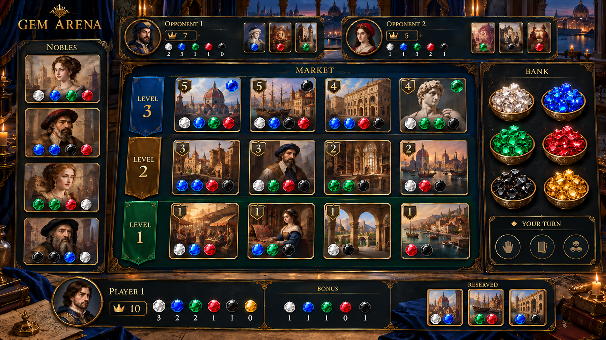

# 개발 일정

일차별 문서와 체크리스트는 [일차별 개발 문서](README.md)를 참고하세요. 총 31일차입니다.

## 멀티 게임판 시각 방향

기존 **25일차**에 서버 상태와 멀티 게임판의 기본 영역을 연결하고, **29일차**에 카드 게임의 몰입감을 주는 화면 배치·조명·연출·반응형·접근성을 다듬는다. **30일차**에 여러 기기에서 2~4인 완주와 화면 표시를 함께 검증한다. 일차 수와 각 일차의 예상 시간은 늘리지 않는다.

시안은 **3인 PC 화면의 분위기와 정보 배치 예시**다. 상단에는 상대의 공개 점수·보석·구매 카드, 중앙에는 귀족과 단계별 공개 시장, 오른쪽에는 보석 은행, 하단에는 내 점수·보유 보석·영구 할인·예약 카드를 둔다. 실제 구현에서는 2~4인에 맞춰 영역 수와 크기를 조절하고, 카드의 색별 비용과 귀족 조건을 숫자로 명확히 표시한다.

29일차 로컬 구현은 2~4인 테이블을 배치하고, 피드백에 따라 시장·예약 카드에 원본 그림의 2:3 비율을 적용했다. 넓은 PC 화면에서는 귀족과 최대 3명의 상대 현황을 왼쪽에, 높이 제한 없는 시장을 중앙에, 은행·행동·내 현황을 오른쪽에 배치한다. 페이지를 스크롤해 카드를 탐색하는 동안 양쪽 자원 현황이 따라온다. 내 현황은 간단 보기와 자세히 보기를 전환한다. 좁은 화면에서는 영역을 세로로 재배치하고, 모바일은 상대·시장 카드 목록의 내부 가로 스크롤을 사용한다. 카드 그림과 조명은 장식으로 사용하며 비용·점수·할인 조건은 숫자와 접근 가능한 이름으로 유지한다. [29일차 기록](daily/day-29.md)에 브라우저 검증 결과와 남은 실기기 점검을 적었다.

하스스톤·유희왕·롤토체스에서 느껴지는 카드 선택의 집중감과 테이블의 깊이감을 참고하되, 화면·로고·캐릭터를 복제하지 않는다. 이 게임은 보석 획득·카드 구매·예약·귀족 방문 게임이므로 전투, 체력, 공격 효과는 넣지 않는다. 상대의 예약 카드 내용과 덱 순서는 숨기고, 황금 보석은 카드 비용이나 영구 할인이 아닌 은행·플레이어 보유량에만 표시한다. 온라인 턴 타이머는 현재 MVP 범위에 포함되지 않는다.
